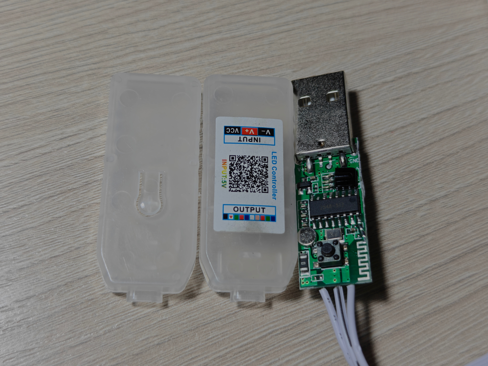

# MelkLamp

##### [Русский](README.md) | [English](README_en.md)

> [!WARNING]
>
> Внимание: приложение не поддерживает английский язык.

Этот проект не имеет никакого отношения к оригинальному приложению LotusLamp X и компании Shenzhen ELK Technology Co. Ltd.

---

MelkLamp - удобное приложение для управления светодиодными лентами на контроллере MELK-OA10 (писалось и тестировалось **исключительно** под него), работающими с приложением "LotusLamp X".

О приложении:

- 100% офлайн и приватность, в манифесте отсутствует разрешение `INTERNET`.

- Material You
---